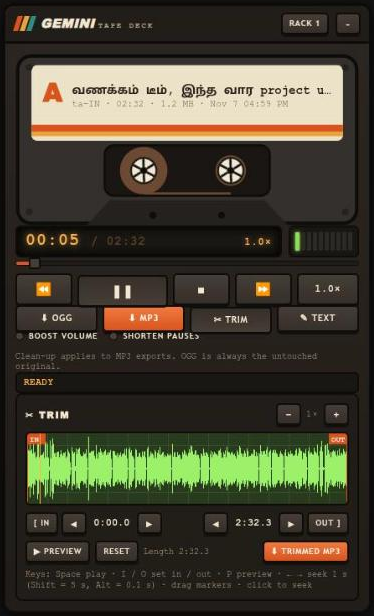
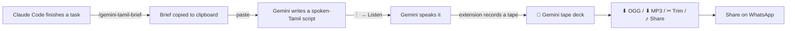

<p align="center">
  
</p>

<h1 align="center">Gemini Listen Downloader</h1>

<p align="center">
  A retro <b>cassette tape deck</b> for gemini.google.com: save the audio Gemini reads aloud when you click <b>Listen</b>,<br>
  download it as <b>OGG</b> or <b>MP3</b>, <b>trim</b> it, <b>boost</b> the volume, <b>shorten pauses</b>, rename, share, and keep a library of your tapes.<br>
  Includes a <b>Claude Code skill</b> that turns finished work into a ready-to-paste prompt, so Gemini explains it in clear spoken <b>Tamil</b>.
</p>

<p align="center"></p>

---

## Contents

- [What you get](#what-you-get)
- [How the pieces fit together](#how-the-pieces-fit-together)
- [Part 1: Install the Chrome extension](#part-1-install-the-chrome-extension)
- [Part 2: Use the tape deck](#part-2-use-the-tape-deck)
- [Part 3: Trim the audio](#part-3-trim-the-audio)
- [Part 4: Tamil voice notes with Claude Code (the skill)](#part-4-tamil-voice-notes-with-claude-code-the-skill)
- [Updating and uninstalling](#updating-and-uninstalling)
- [Troubleshooting](#troubleshooting)
- [Privacy and security](#privacy-and-security)
- [Project structure](#project-structure)
- [For developers](#for-developers)
- [Limitations](#limitations)
- [License and credits](#license-and-credits)

---

## What you get

| Piece | What it does | Who needs it |
|---|---|---|
| **Chrome extension** (`extension/`) | Adds a retro **tape deck** to gemini.google.com. Every time you click **Listen**, the audio is recorded as a tape: play it, download **OGG** / **MP3**, **trim** it, **boost** quiet speech, **shorten pauses**, rename it, copy the spoken text, share it, and find it again later in the **tape rack**. | Anyone who wants to save Gemini's spoken answers |
| **Claude Code skill** (`skills/gemini-tamil-brief/`) | When Claude Code finishes a task, `/gemini-tamil-brief` writes a complete, fact-checked summary with instructions that make Gemini answer in natural spoken Tamil, ready for **Listen**. | People who use [Claude Code](https://claude.com/claude-code) and share updates with a Tamil-speaking team |

You can use the extension on its own. The skill is optional.

> The extension works for **any language** Gemini can speak. Only the skill is Tamil-specific,
> and you can change it to another language (see [Use a different language](#use-a-different-language)).

---

## How the pieces fit together



Without Claude Code, start at step C: ask Gemini anything, click **Listen**, download.

---

## Part 1: Install the Chrome extension

**You need:** Google Chrome (or Microsoft Edge, Brave or another Chromium browser) on a
**computer** (Windows, macOS or Linux). Phone browsers don't support extensions.

Installing takes about 2 minutes. The extension isn't in the Chrome Web Store, so you load it
from a folder ("Load unpacked"). This is normal and safe for extensions you got from a trusted source.

### Step 1: Get the files

Pick **one** of these:

**Option A: download the release ZIP (easiest)**

1. Open the [latest release](https://github.com/sivaezhumalai/gemini-listen-downloader/releases/latest)
   and download **`gemini-listen-downloader-<version>.zip`** (under *Assets*).
2. Find the ZIP in your **Downloads** folder and **extract / unzip** it
   (Windows: right-click → *Extract All…*; macOS: double-click; Linux: right-click → *Extract Here*).
3. You now have a folder named **`gemini-listen-downloader`** with `manifest.json` inside.
   That's the folder Chrome needs.
4. Move it somewhere permanent, such as `Documents`.
   **Don't delete it after installing**: Chrome loads the extension from this folder every time.

**Option B: download the whole repository**

Click the green **`<> Code`** button → **Download ZIP** and unzip it. The folder Chrome needs is
`gemini-listen-downloader-main/extension`. (This includes the Claude skill and docs too.)

**Option C: with git**

```bash
git clone https://github.com/sivaezhumalai/gemini-listen-downloader.git
```

The folder you need is `gemini-listen-downloader/extension`.

### Step 2: Open the extensions page

Type this in Chrome's address bar and press **Enter**:

```
chrome://extensions
```

(Edge: `edge://extensions` · Brave: `brave://extensions`)

### Step 3: Turn on Developer mode

Find the **Developer mode** switch in the **top-right corner** of the page and turn it **on**.
Three new buttons appear on the left: *Load unpacked*, *Pack extension* and *Update*.

### Step 4: Load the extension

1. Click **Load unpacked**.
2. In the folder picker, select the folder from Step 1 that **directly contains `manifest.json`**
   (`gemini-listen-downloader` from the release ZIP, or the `extension` folder from the repository),
   then click **Select** / **Open**.

   > **Tip (Linux/Windows):** in the folder picker press **Ctrl+L**, paste the full path to the
   > `extension` folder and press **Enter**.

3. A card named **Gemini Listen Downloader** appears, with a blue icon. Make sure its switch is **on**.

> **"Manifest file is missing or unreadable"?** You picked the wrong folder. Pick the folder that
> directly contains `manifest.json` (the `extension` folder), not its parent.

### Step 5: Reload Gemini

If gemini.google.com is already open, **reload the tab** (F5 / Cmd+R). The extension only
starts on pages loaded after it was installed.

That's it. There's no toolbar button to click: the extension works by itself on gemini.google.com.

---

## Part 2: Use the tape deck

1. Open [gemini.google.com](https://gemini.google.com) and ask anything, for example
   *"Explain how UPI works, in simple Tamil."*
2. Under the answer, click **⋮** (More) → **🔊 Listen**, or use the **▶** button at the top of the chat.
3. As soon as Gemini starts speaking, the **GEMINI TAPE DECK** opens in the **bottom-right corner**
   with the audio loaded as a cassette ("a tape"). The status line says **NEW TAPE RECORDED**.

<p align="center"></p>

### The controls

| Part | What it does |
|---|---|
| **Cassette label** | The tape's name, then language · length · size · date. **Click the name to rename it.** The new name is used for the downloaded files. |
| **Reels** | Spin while playing. The tape moves from the left reel to the right one as it plays. |
| **LCD counter** | Current time / total time, and the playback speed |
| **VU meter** | Lights up with the loudness while playing |
| **Tape track** | Drag to jump anywhere in the tape |
| **⏪ ▶/❚❚ ■ ⏩** | Back 5 s · Play/Pause · Stop (back to start) · Forward 5 s |
| **1.0×** | Playback speed: 0.75× → 1× → 1.25× → 1.5× → 2×. Only for listening. **Downloaded files always keep normal speed.** |
| **⬇ OGG** | Saves the **original** audio exactly as Gemini sent it. Instant, smallest file. |
| **⬇ MP3** | Converts to MP3 **inside your browser**, then saves. Plays **everywhere**, including iPhones. A 2½-minute tape takes about 10 seconds; the status line shows `ENCODING MP3 45%`. |
| **✂ Trim** | Opens the trim drawer (see [Part 3](#part-3-trim-the-audio)) |
| **✎ Text** | Shows the text Gemini spoke, with **Copy text** |
| **⤴ Share** | Opens your system's share sheet with the MP3 (WhatsApp, Mail, Nearby Share…). The first press prepares the MP3; press **Share now** to share. Only shown where Chrome supports file sharing (Windows, ChromeOS, macOS). |
| **● Boost volume** | MP3 exports: makes quiet speech louder (without distortion), good for phone speakers |
| **● Shorten pauses** | MP3 exports: shortens silences longer than 0.6 s down to about ⅓ s, so the voice note is tighter |
| **Status line** | What just happened: progress, "Saved 346 KB · 0.5 s of pauses cut", errors |
| **RACK n** (header) | Opens the **tape rack**, your saved library (see below) |
| **–** (header) | Minimise to a small **TAPES (n)** button. Its **✕** hides it until the next Listen. |

The two clean-up switches are remembered, and their LEDs glow when they're on. They only change
**MP3** exports, and the file name says so: `… (boosted) (tight).mp3`. **OGG is always the untouched original.**

### Which format should I send?

| You want to… | Use |
|---|---|
| Send on WhatsApp / Telegram to Android users | **OGG** (smallest, original quality) or MP3 |
| Send to iPhone users, by email, or to any device | **MP3** |
| Keep the best possible quality | **OGG** (MP3 is a re-encode) |
| Make a quiet or slow recording easier to follow | **MP3** with **Boost volume** and/or **Shorten pauses** |

### The tape rack (your library)

Every tape is **saved automatically** in your browser, so it's still there after you reload Gemini
or restart Chrome. After a reload, a small **TAPES (n)** button appears in the corner; click it
to open the deck with your newest tape loaded.

- Click **RACK** to see all saved tapes (name, date, length, size, language).
- Click a tape to load it into the deck.
- **✕** deletes a tape (click once, then **Sure?** to confirm). **Clear all** works the same way.
- The rack keeps your **last 30 tapes**; older ones are removed automatically.
- If you click **Listen** again on an answer you already have, the deck loads the existing tape instead of making a duplicate.
  This also works when Gemini replays audio without downloading it again.

### File names

Created from the language and the first words of the answer, or from your own name if you renamed the tape:

```
gemini-ta-IN-UPI எப்படி வேலை செய்யுது-2026-11-07_15-24-10.ogg
Team update Nov 7.mp3
Team update Nov 7 (boosted) (tight).mp3
Team update Nov 7 (00m29s-00m59s).mp3        ← a trimmed part
```

---

## Part 3: Trim the audio

Cut away the parts you don't need, such as the first sentence or the ending, and save only the middle.

1. Click **✂ Trim**. A green **oscilloscope** screen shows the sound (tall = loud, flat = silence),
   with an orange **IN** marker (start) and **OUT** marker (end). The bright part is what you'll keep.
2. Set the start and the end, whichever way is easiest:
   - **Drag** the IN / OUT markers on the screen.
   - **While it plays**, press **[ In** at the right moment, and **Out ]** where it should stop.
   - Fine-tune with the small **◂ ▸** buttons next to each time (±0.1 s each press). The player
     jumps there so you can hear the exact cut point.
   - Click anywhere else on the screen to move the playhead (amber line) there.
   - Use **+ / −** to zoom in (up to 16×) for precise cuts. While playing, the view follows the playhead.
3. Click **▶ Preview** to hear only the selected part. It stops by itself at OUT.
   **Reset** selects the whole tape again.
4. Click **⬇ Trimmed MP3**. The file name includes the times, for example `… (00m29s-00m59s).mp3`.

Notes:
- A tiny 10 ms fade is added at both ends so the cut doesn't click.
- **Boost volume** and **Shorten pauses** also apply to trimmed MP3s when switched on.
- Trimmed files are **MP3 only**. **⬇ OGG** always gives the full original.

### Keyboard shortcuts

Click anywhere on the deck first, so it has keyboard focus.

| Key | Action |
|---|---|
| **Space** | Play / pause |
| **I** | Set **IN** (start) at the playhead |
| **O** | Set **OUT** (end) at the playhead |
| **P** | Preview the selection / stop |
| **← / →** | Seek 1 s back / forward |
| **Shift + ← / →** | Seek 5 s |
| **Alt + ← / →** | Seek 0.1 s (fine) |

---

## Part 4: Tamil voice notes with Claude Code (the skill)

### What it is

[Claude Code](https://claude.com/claude-code) is Anthropic's AI coding assistant. A **skill** is a
small instruction file that teaches Claude a repeatable job. This repo includes the
**`gemini-tamil-brief`** skill: when Claude finishes some work, it writes a brief for Gemini.

The brief has two parts:

1. **Instructions for Gemini**, so its answer works as a voice note: everyday spoken Tamil
   (பேச்சுத் தமிழ்), technical words kept in English and explained once, numbers written the way
   they're said, no headings, bullets, links or emojis (they'd be read aloud), starting directly with
   *"வணக்கம் டீம்"*, and nothing after the closing line.
2. **A complete English summary of the work** in fixed sections: context, problem, cause,
   what we did, results with numbers, how it was checked (including what was *not* tested),
   pending risks, **actions for each person or role**, and terms to explain.

Before writing, Claude removes keys, passwords, internal links and customer details, because
the text goes to Gemini and then to everyone who hears the audio.

See a real example: [`docs/example-brief.txt`](docs/example-brief.txt).

### Install the skill

**You need:** Claude Code installed (`claude` command works in your terminal).

**macOS / Linux / Git Bash on Windows**, from the repo folder:

```bash
bash scripts/install-skill.sh
```

**Windows PowerShell**, from the repo folder:

```powershell
powershell -ExecutionPolicy Bypass -File scripts\install-skill.ps1
```

**Or copy it by hand:** copy the folder `skills/gemini-tamil-brief` into your Claude skills folder:

| System | Skills folder |
|---|---|
| macOS / Linux | `~/.claude/skills/` |
| Windows | `C:\Users\<you>\.claude\skills\` |

so that this file exists: `~/.claude/skills/gemini-tamil-brief/SKILL.md`.

**Installer options** (`install-skill.sh`):

| Command | Effect |
|---|---|
| `bash scripts/install-skill.sh` | Copy the skill for all your projects (default) |
| `bash scripts/install-skill.sh --link` | Symlink instead, so `git pull` keeps the skill up to date |
| `bash scripts/install-skill.sh --project /path/to/project` | Install for one project only (`<project>/.claude/skills/`), which you can commit to share with that project's team |

If a copy already exists, the installer moves it to `~/.claude/skill-backups/` first.

**Start a new Claude Code session** after installing, so it picks up the skill.

### Use the skill

1. Do your work with Claude Code as usual: fix a bug, ship a feature, investigate an incident.
2. When it's done, type:

   ```
   /gemini-tamil-brief
   ```

   Or just say it in your own words: *"share this with the team as a Tamil voice note"*.
   You can name the audience: *"/gemini-tamil-brief for the support team, they are non-technical"*.

3. Claude:
   - writes the brief from what actually happened in the session,
   - saves it to `~/gemini-briefs/<date>-<topic>.txt`,
   - **copies it to your clipboard** (macOS `pbcopy`, Linux `wl-copy`/`xclip`, Windows `clip.exe`),
   - shows it to you so you can read it first.

4. Open [gemini.google.com](https://gemini.google.com), **paste** (Ctrl+V / Cmd+V) and send.
5. Gemini replies with the Tamil voice-note script. Read it quickly and fix anything wrong.
6. Click **⋮ → Listen** → in the **tape deck** click **⬇ MP3** (switch on **Boost volume** / **Shorten pauses** if you like, or **✂ Trim** first).
7. Share the file with your team.

**Tips for the best audio**

- Read the brief before pasting. Claude marks anything unverified as "not yet tested", so keep that honesty in.
- If Gemini adds an intro or a follow-up question anyway, ask *"remove the first line and the
  last question"* before clicking Listen, or cut them with **✂ Trim**.
- Long updates make long audio. For a short version, ask Claude: *"/gemini-tamil-brief, keep it under 2 minutes"*.

### Use a different language

Open `skills/gemini-tamil-brief/SKILL.md` (or your installed copy) and, in the
*Gemini instructions* block, replace *Tamil / பேச்சுத் தமிழ்*, the greeting *"வணக்கம் டீம்"*
and the number examples with your language's equivalents. Rename the folder and the
`name:` line (for example `gemini-hindi-brief`) if you want both.

---

## Updating and uninstalling

**Update the extension**
1. Get the new files (`git pull`, or download the ZIP again and replace the old folder).
2. Go to `chrome://extensions` and click the **↻** (reload) icon on the *Gemini Listen Downloader* card.
3. Reload your Gemini tab.

**Update the skill:** run the installer again (or use `--link` once, then `git pull` is enough).

**Uninstall the extension:** `chrome://extensions` → *Gemini Listen Downloader* → **Remove**.

**Uninstall the skill:** delete `~/.claude/skills/gemini-tamil-brief`.

---

## Troubleshooting

| Problem | Fix |
|---|---|
| **The deck doesn't open after clicking Listen** | 1) Reload the Gemini tab (needed once after installing or updating). 2) Check the extension's switch is on in `chrome://extensions`. 3) If you hid the deck with the small **✕**, it comes back on the next Listen or page reload. |
| Still nothing | Open DevTools (**F12**) → **Console** and look for lines starting with `[Gemini Listen Downloader]`. If you see `ready: …` but nothing when you click Listen, Google may have changed Gemini's internals: see [docs/HOW-IT-WORKS.md](docs/HOW-IT-WORKS.md#3-if-it-stops-working) and open an issue. |
| **No ⤴ Share button** | Your system doesn't support sharing files from Chrome (common on Linux). Use ⬇ MP3 and share the file. |
| **Keyboard shortcuts do nothing** | Click on the deck first so it has focus. Shortcuts are ignored while you're typing a new name. |
| **Rack says "Library unavailable"** | Chrome is blocking site storage for gemini.google.com (for example in Incognito or with "Block third-party/site data" settings). Tapes still work until you reload. |
| **Tapes disappeared from the rack** | Clearing browsing data / site data for gemini.google.com also clears the tape rack. The rack keeps the last 30 tapes. |
| **Chrome asks where to save every file** | That's your Chrome setting: Settings → Downloads → *Ask where to save each file before downloading*. Turn it off to save straight to Downloads. |
| **"MP3 failed – retry"** | Click it again. If it keeps failing, use **⬇ OGG** and convert it elsewhere (for example `ffmpeg -i in.ogg -b:a 96k out.mp3`), and please open an issue with the Console messages. |
| **Tamil text shows as boxes (□□□) on the deck** | Your computer is missing a Tamil font. Install **Noto Sans Tamil** (free from Google Fonts) and restart Chrome. The audio isn't affected. |
| **"Manifest file is missing or unreadable"** when loading | Select the `extension` folder itself (the one with `manifest.json` inside). |
| Extension disappeared after a restart | You deleted or moved the folder you loaded. Put it back, or load it again from the new place. |
| Chrome shows a "Disable developer mode extensions" message | Normal for unpacked extensions. Click ✕ or **Keep**. |
| `/gemini-tamil-brief` isn't recognised | Start a **new** Claude Code session after installing. Check that `~/.claude/skills/gemini-tamil-brief/SKILL.md` exists. |
| Brief wasn't copied to the clipboard | Linux: install `wl-clipboard` (Wayland) or `xclip` (X11). Or open the saved file in `~/gemini-briefs/` and copy it. |

---

## Privacy and security

- The extension runs **only on `https://gemini.google.com/*`**.
- It **sends nothing anywhere** and makes **no extra network requests**. It keeps a copy of the
  audio Gemini's own page already downloaded.
- It asks for **no extension permissions** (no tabs, storage, cookies or browsing history).
- Tapes in the **rack** are stored **only in your browser** (IndexedDB storage of gemini.google.com on this computer).
  They never leave your machine. Delete them with **✕** / **Clear all**, or by clearing site data for gemini.google.com.
- Your clean-up switch and speed settings are stored in the same site's local storage.
- MP3 conversion and trimming happen **on your computer**.
- All code is plain, readable JavaScript in `extension/`. The only third-party code is the MP3
  encoder in `extension/vendor/lame.min.js` (lamejs 1.2.1, unmodified).
- **Don't commit or share** your downloaded audio or HAR files if they contain private
  conversations. This repo's `.gitignore` already excludes `*.ogg`, `*.mp3`, `*.har` and `out/`.
- The skill tells Claude to remove secrets and personal data before writing the brief. Still,
  **read the brief before pasting it into Gemini**.

---

## Project structure

```
gemini-listen-downloader/
├── extension/                 ← load THIS folder in chrome://extensions
│   ├── manifest.json          Extension definition (Manifest V3)
│   ├── content.js             Captures Listen audio (and replays) + the tape deck UI
│   ├── parse.js               Reads Gemini's request/response, decodes the audio
│   ├── audio.js               Waveform, selection, slicing, fades, boost, pause shortening, decoding
│   ├── store.js               Tape rack (IndexedDB library)
│   ├── mp3.js                 MP3 encoding (via LAME)
│   ├── icons/                 Extension icons
│   └── vendor/
│       ├── lame.min.js        lamejs 1.2.1 (LGPL-3.0, unmodified)
│       └── LAME-LICENSE.txt
├── skills/
│   └── gemini-tamil-brief/
│       └── SKILL.md           The Claude Code skill
├── scripts/
│   ├── install-skill.sh       Skill installer (macOS / Linux / Git Bash)
│   ├── install-skill.ps1      Skill installer (Windows PowerShell)
│   └── package.js             Builds dist/gemini-listen-downloader-<version>.zip
├── docs/
│   ├── HOW-IT-WORKS.md        Technical notes and how to fix it if Gemini changes
│   ├── example-brief.txt      Example output of the skill
│   └── images/tape-deck.png   Screenshot
├── test/
│   ├── parse.test.js          Tests for parsing, decoding, file names, MP3 encoding
│   ├── audio.test.js          Tests for trim helpers
│   └── dsp.test.js            Tests for boost, pause shortening, fingerprints
├── package.json               npm scripts (no dependencies)
└── LICENSE
```

---

## For developers

No build step and no dependencies. You only need **Node.js 18+** for tests and packaging.

```bash
npm test             # unit tests (parsing, decoding, file names, MP3 encoding, trim, boost, pauses)
npm run check        # syntax-check every extension script
npm run package      # build dist/gemini-listen-downloader-<version>.zip
```

**Test against a real capture (optional):** in Chrome DevTools → Network, click Listen in Gemini,
then **⤓ Export HAR**, and run:

```bash
HAR=/path/to/gemini.google.com.har npm test
```

A HAR file contains your cookies and conversation, so keep it out of the repo (it's in `.gitignore`).

**Development loop:** edit files in `extension/` → `chrome://extensions` → **↻** on the card → reload Gemini.
Console logs are prefixed with `[Gemini Listen Downloader]`.

How the capture works, and what to change if Google changes Gemini, is in
[docs/HOW-IT-WORKS.md](docs/HOW-IT-WORKS.md).

**Releasing:** bump `version` in `extension/manifest.json` and `package.json`, run `npm run package`,
and attach the ZIP from `dist/` to a GitHub Release.

---

## Limitations

- **Desktop Chromium browsers only** (Chrome, Edge, Brave…). Not Firefox, Safari or phones.
- Relies on Gemini's **internal, undocumented** API. If Google changes it, the deck stops
  opening until the extension is updated (usually a one-line fix in `parse.js`).
- Replay capture reads the audio Gemini's own player is about to play. If Gemini ever plays audio
  another way, reload the tab and click Listen again to capture the original request.
- The tape rack lives in your browser profile on this computer only; it doesn't sync between devices.
- Very long answers that Gemini might split into several audio parts haven't been tested; each part
  would show as its own clip.
- Trimmed and cleaned-up exports are MP3 only (OGG is always the untouched original).

---

## License and credits

- Project code: **MIT** (see [LICENSE](LICENSE)).
- MP3 encoding: [lamejs](https://github.com/zhuker/lamejs) 1.2.1, a JavaScript port of
  [LAME](https://lame.sourceforge.io), **LGPL-3.0**, included unmodified in `extension/vendor/`.

This project isn't affiliated with, endorsed by or sponsored by Google or Anthropic. *Gemini* is a
trademark of Google LLC; *Claude* and *Claude Code* are trademarks of Anthropic PBC.
Use the downloaded audio in line with Gemini's terms of service.
